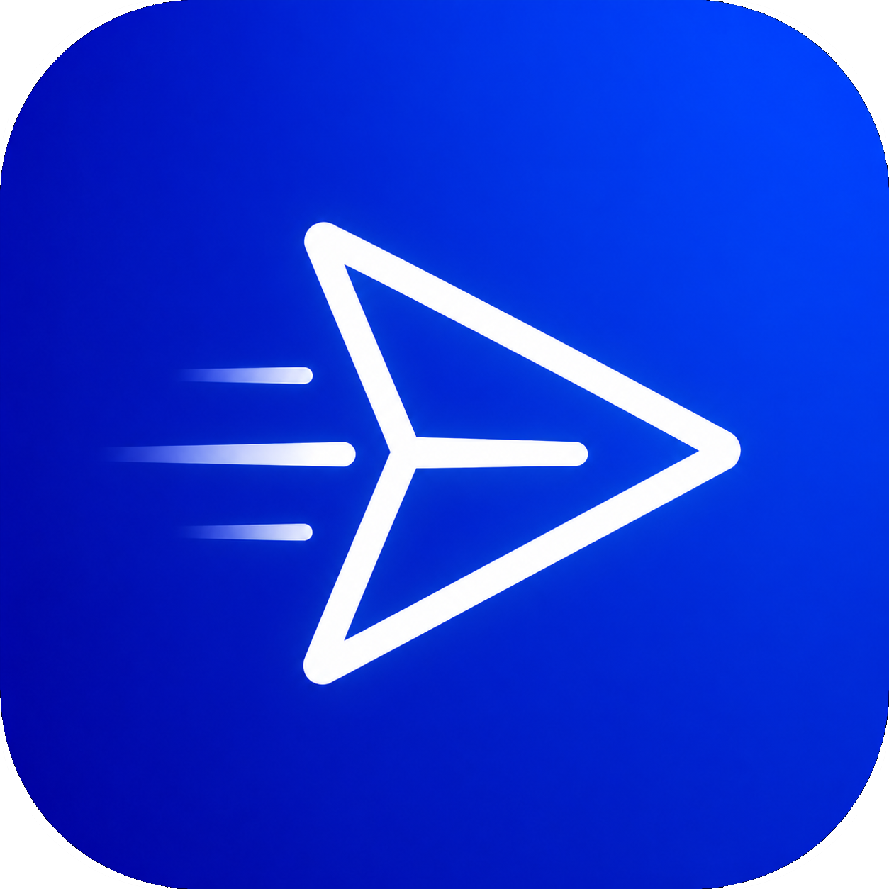

<p align="center">
  
</p>

<h1 align="center">OneDrop</h1>

<p align="center">Send text and files between your own devices through your OneDrive.</p>

<p align="center">
  <a href="https://onedrop.sycamore.top">Website</a> ·
  <a href="https://github.com/zixu0779/OneDrop/releases">Releases</a> ·
  <a href="docs/installation.md">Installation guide</a>
</p>

<p align="center">
  <a href="https://github.com/zixu0779/OneDrop/actions/workflows/ci.yml"></a>
  <a href="https://github.com/zixu0779/OneDrop/releases/latest"></a>
</p>

## Features

- **Text and files across devices.** Send notes, links, images, and attachments, then pick them up on another OneDrop client.
- **Your OneDrive storage.** Sign in with Microsoft; messages and files live in your account’s OneDrive App Folder. No separate OneDrop account or application server.
- **Up to three accounts.** Switch between saved accounts with separate messages, drafts, and transfers. Only the active account synchronizes.
- **Recover deleted messages.** Restore messages from the recycle bin during the configured retention period.
- **Make it yours.** Choose an account avatar that syncs across devices, plus a theme and text size for each installation.
- **Updates in Settings.** Check version availability in About, with platform-specific download or installation actions. Desktop store updates remain managed by Edge.

## Installation

| Client              | Get OneDrop                                                                                                                                                                                               |
| ------------------- | --------------------------------------------------------------------------------------------------------------------------------------------------------------------------------------------------------- |
| Desktop Edge        | [Edge Add-ons](https://microsoftedge.microsoft.com/addons/detail/onedrop/omfponfedcemkidfmpkojmhfofgmfmgh), or load the desktop ZIP from [Releases](https://github.com/zixu0779/OneDrop/releases/latest). |
| Android Edge Canary | Import the mobile CRX using [developer installation](docs/installation.md#android-edge).                                                                                                                  |
| Native Android      | Install the signed APK from [Releases](https://github.com/zixu0779/OneDrop/releases/latest). Requires Android 7.0 or newer.                                                                               |
| iOS Edge TestFlight | Import the mobile CRX using [developer installation](docs/installation.md#ios-edge).                                                                                                                      |
| Native iOS          | Install the IPA through [LiveContainer](docs/installation.md#native-ios-through-livecontainer).                                                                                                           |

For native iOS (using [LiveContainer](https://github.com/LiveContainer/LiveContainer)), the source URL is `https://onedrop.sycamore.top/apps.json`.

See the [installation guide](docs/installation.md) for platform requirements and upgrade steps. Native iOS requires LiveContainer.

## Development

Requires Node.js 22 or newer. Install dependencies and create your local configuration:

```bash
npm ci
cp .env.example .env.local
```

Set `WXT_ONEDROP_ENTRA_CLIENT_ID` in `.env.local` to your Microsoft Entra application client ID. Configure the matching redirect URIs before signing in; see [authentication setup](docs/authentication.md).

Start the desktop Edge development client:

```bash
npm run dev
```

If Edge does not open automatically, load `.output/edge-mv3-dev` from `edge://extensions`.

Run checks and build:

```bash
npm run compile
npm test
npm run lint
npm run format:check
npm run build
```

The shared UI also builds with `npm run build:android` and `npm run build:ios`. Native Android development requires JDK 21 and Android SDK 36; native iOS development requires macOS and Xcode.

Use `npm run sync:android` / `npm run sync:ios`, then `npm run open:android` / `npm run open:ios` to work in the native IDE.

See [architecture](docs/architecture.md) for the shared packages, synchronization, and storage model. Dependency compatibility patches in `patches/` are applied automatically by `npm ci` through `patch-package`.

## Privacy

Read the [Privacy Policy](https://onedrop.sycamore.top/privacy-policy.html) for how OneDrop handles your data.
